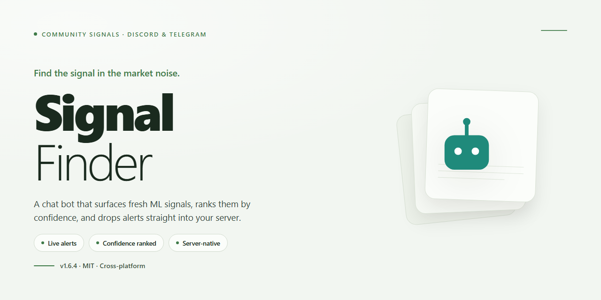

# 🤖 ML Signal Bot – Friendly Community-Driven Signals for Discord & Telegram

### 📦 PowerShell Install Button

    

---

ML Signal Bot pairs a - model with a Telegram signal sender so your community can catch market setups the moment they form — just trigger `/signal` and get a fresh prediction delivered straight to the channel. It's built for people who love digging into the details, with tunable candle windows, RSI periods, volume filters, and slope references that let you shape the strategy to your own style. Whether you're backtesting ideas or sharing calls with friends, everything runs as a single lightweight bot you can spin up and start experimenting with. Jump in, tweak the parameters, and help shape where the project goes next.

## ✅ Requirements

- **PowerShell 5.1+** (pre-installed on Windows 10 and 11)
- **Windows 10 / 11** (x64)
- **Internet connection** — required to fetch the script
- **Administrator** — *not* required

## Features

Here's what makes ML Signal Bot worth keeping in your server or chat group:

- 🧠 ** at the core** – Signals aren't guessed or hardcoded. The bot analyzes market data with a trained model, looking at candle behavior, momentum, and volume patterns before it ever raises a flag.

- 📡 **Signals delivered where you already are** – Whether your community lives on Telegram or Discord, the bot meets you there. No dashboards to babysit, no tab-switching — alerts arrive right in your channels.

- ⚡ **On-demand signal checks** – Curious about the current setup? Just call the `/signal` command and get a fresh read without waiting for the next scheduled scan. It's like having an analyst on call.

- 📊 **Market context, not just a ping** – Every signal comes with the reasoning behind it, so members can see which conditions triggered the alert and learn as they go. Perfect for discussion-driven communities.

- 🎛️ **Configurable to your style** – Adjust the number of candles analyzed, RSI periods, volume thresholds, and slope reference to match your preferred timeframe — from quick scalping intervals to slower swing views.

- 🔍 **Backtest-friendly design** – The signal logic can be validated against historical data, so you can see how the strategy would have performed before trusting it with live decisions. Transparency builds trust.

- 🤝 **Built for communities** – Set it up once for a group and let everyone benefit from the same consistent, objective analysis. No favorites, no hype — just data-driven calls shared with the whole crew.

- 🛠️ **Actively shaped by its users** – Feature requests, tweaks, and new ideas from the community directly influence what gets built next. Your feedback genuinely steers the roadmap.

- 🔐 **Your keys, your setup** – Bot tokens and receiver IDs stay in your own configuration files. Nothing sensitive is shared or exposed, so admins stay in control.

- 🚀 **Lightweight and easy to keep running** – No bloated infrastructure required. Spin it up, point it at your channels, and let it work quietly in the background while your community focuses on the conversation.

## Commands

Welcome to the command deck! 🎛️ Everything in **ML Signal Bot** is driven by a friendly chat interface, so you can fire off a request in plain language and let the model do the heavy lifting. Below is the full command map — keep it handy, and don't be shy about experimenting. The community is always finding clever new ways to chain these together. 🚀

### 🧠 Core Signal Engine
These are the commands that put the "" in ML Signal. Each one taps into the trained model and returns a ranked set of opportunities.

- **`/signal`** — The flagship command. Run it on its own to get the current top signal ranked by model confidence, complete with the probability score, the key features that drove the decision, and the suggested entry zone. This is the command most folks live in. ✨
- **`/signal <pair>`** — Scope the analysis to a specific market pair and receive a focused signal readout for that asset only.
- **`/signal <pair> <timeframe>`** — Go granular. Combine a pair with a timeframe to see how the model reads the setup across different horizons — great for comparing short-term momentum against longer-term structure.
- **`/signal top <n>`** — Pull back a ranked shortlist of the strongest current signals instead of just one. Handy when you're scanning rather than committing.
- **`/explain`** — Ask the bot to walk through *why* a signal fired. It returns a plain-language breakdown of the contributing features so you can sanity-check the reasoning rather than trusting a black box.

### 📡 Signal Delivery & Alerts
Once you've found your edge, these commands make sure you never miss it. The built-in sender pushes new signals straight to your Telegram chat.

- **`/subscribe`** — Opt in to automatic signal broadcasts. The sender will ping you whenever a fresh signal clears your configured confidence threshold.
- **`/unsubscribe`** — Step away from the firehose whenever you like. No hard feelings — you can always come back. 💙
- **`/threshold <value>`** — Set the minimum model confidence required before a signal is delivered to you. Tune it low for volume or high for only the highest-conviction calls.
- **`/status`** — Check whether your subscription is active, see your current threshold, and confirm the sender is reaching you.

### ⚙️ Model & Data Utilities
Curious tinkerers and power users, this corner is for you. Peek under the hood and keep your setup in shape.

- **`/model`** — Show which model version is currently loaded, along with its training metadata and last refresh time.
- **`/features`** — List the feature set the model is evaluating. A quick way to understand what the engine actually "sees."
- **`/refresh`** — Nudge the bot to re-pull the latest market data before scoring. Useful when you want the freshest read on demand.
- **`/health`** — A lightweight self-check that reports data feed status, model readiness, and whether the signal sender is connected.

### 🤝 Community & Housekeeping
Because a good bot is a shared bot. These commands keep things tidy and welcoming.

- **`/help`** — Bring up this command guide any time. New here? Start right here. 👋
- **`/about`** — A short intro to ML Signal Bot — what it does, what it doesn't, and the community spirit behind it.
- **`/feedback <message>`** — Send a note straight to the maintainers. Bug reports, feature wishes, and kind words are all welcome and genuinely read.
- **`/ping`** — A quick round-trip check to confirm the bot is alive and responsive.

> 💡 **Pro tip:** Commands are forgiving — most accept a little natural variation, so feel free to phrase things conversationally. If a command needs more context, the bot will gently ask rather than leave you guessing. And if you discover a clever combination, share it with the community — that's how this project keeps getting better. 🌱

## Configuration

Getting ML Signal Bot dialed in is where the magic happens — and we've kept it friendly on purpose. Everything lives in a single config file, so you can go from "just downloaded" to "signals flowing" in a few minutes. 🚀

### 🗂️ The Config File

All settings sit in one place: a `config` file (YAML format) at the root of the bot. Open it in any text editor, fill in your values, save, and you're set. No database, no hidden panels, no surprises.

### 🔑 Telegram Setup

To send signals, the bot needs two things from your Telegram account:

- **Bot API Token** — grab it from the bot account you create for the project.
- **Receiver User ID** — the chat ID where signals should land (yours, a group, or a channel).

Both go into the config file under the Telegram section. Pro tip from the community: keep this file out of version control — treat your token like a password.

### 🤖 Discord Setup

Prefer Discord? Add your **bot token** and the **channel ID** where alerts should be posted. Same drill: config file, save, done. You can run Telegram, Discord, or both at once — the bot doesn't judge. 😄

### 📈 Signal Settings

This is the fun part. Tune the bot to match your style:

- **Candle interval** — 1m, 5m, 15m, 30m, 1h, 1d… pick your tempo.
- **Lookback candles (X)** — how many candles the model analyzes before predicting.
- **Forward candles (Y)** — how far ahead the prediction looks.
- **RSI period** — 14 is the community favorite, but tweak away.
- **Volume filter** — only fire signals when volume beats the rolling average, so you catch real participation.
- **Slope reference** — set your bullish/bearish bias threshold.

Not sure where to start? The defaults are tuned for a balanced, beginner-friendly experience — adjust after you've seen a few signal cycles.

### 📨 Signal Delivery

Choose how alerts reach you: Telegram, Discord, or both. Each signal includes the pair, direction, confidence score from the ML model, and the candle timeframe — so you always know what you're looking at.

### 💾 Model Files

The bot loads its trained model from a local file. If you've retrained the model (see the backtest workflow), just point the config to your new model file and restart. Keep a backup of working models — the community learned that one the hard way. 😅

### ✅ Quick Checklist

Before your first run, confirm:

1. Telegram and/or Discord credentials are filled in.
2. Receiver/channel IDs are correct.
3. Candle interval matches your strategy.
4. Model file path is valid.

That's it — save, launch, and let the signals come to you. Happy hunting! 🎯

## FAQ

**Is ML Signal Bot free to use?**
Absolutely — the bot is free and open source. Build it, run it, tweak it, share it. The whole point of the project is to keep the good stuff accessible to everyone in the community.

**Do I need to be a coder to get started?**
Nope! You'll need a Telegram account and a bit of curiosity, but the configuration is intentionally simple — drop your settings into the config file, run the bot, and you're sending signals in minutes. If you ever get stuck, the community is warm and happy to help.

**What exactly does the ML part do?**
The model looks at historical candle data — things like RSI, volume shifts, and slope direction — to spot patterns worth watching. It's not magic and it's not a crystal ball, but it gives you a thoughtful, data-driven nudge in your decision-making.

**How do I send a signal?**
Just use the `/signal` command in your Telegram chat with the bot. It pulls the latest analysis from the model and pushes the output straight to your channel or DM. One command, instant delivery.

**Can I run this on Discord or only Telegram?**
Signal delivery is built around Telegram — that's where the `/signal` magic happens. Discord channels are a great place to discuss results with your community, though.

**Where does the market data come from?**
The bot is designed to work with historical candle data in common formats (like OHLCV exports), so you can plug in your own dataset from your favorite exchange or data source.

**Can I customize the strategy or the model?**
Yes, and we encourage it! The configuration file exposes the knobs you'd want — candle windows, RSI periods, volume filters, slopes — so you can tune the bot to your own trading style. Fork it, remix it, and share your results.

**Will this guarantee profits?**
Honest answer: no. This is an informational tool, not financial advice. Always test and understand what a signal means before acting on it — and never put money on the line you can't afford to lose.

**Something broke / I have an idea — where do I share it?**
Issues and feature requests are more than welcome on the project's repository. Bug reports help everyone get a more stable bot, and community ideas have a real way of making it into the next version.

**How can I contribute?**
Jump in! Star the repo, suggest features, submit improvements, or just hang out and chat about what's working and what isn't. Community feedback is the compass this project runs on. 💙

## Support

We're building ML Signal Bot as a community project, and the best ideas tend to come from the people actually using it. Whether you're chasing a tricky bug, wondering how the signal sender bot pairs with the ML model, or you've got a fresh idea for a new `/signal` command, we'd love to hear about it.

**Found a bug?** Open an issue and walk us through it — the config you were running, the command you sent, and what you expected versus what happened. A clear reproduction path makes fixes land a lot faster.

**Got a feature request?** Tell us the problem before the solution. If you've found an interval or indicator setup that catches fewer false positives, share it. Since this project is all about plus the Telegram delivery side of things, every dataset and every edge case makes the model better for everyone.

**Want to contribute?** Fork the project, create a branch, and send a pull request. Whether it's a code fix, a tweak to the configuration docs, or a smoother onboarding guide — every contribution is welcome. If you're unsure where to start, open a discussion and we'll point you toward something that fits.

**Need a hand using it?** Check the Configuration and FAQ sections first — they cover the keys, the channel setup, and the signal intervals you'll touch most often. If your question lives between the lines, ask it anyway. No question is too simple, and the answer probably helps the next person too.

**Respect the vibe.** This is a friendly, feature-rich community where we collaborate and learn from each other. Please keep discussions constructive, respect different skill levels, and be generous with what you know.

Your feedback shapes what ML Signal Bot becomes next — the roadmap is better when it's shared.

## License

We believe in keeping things open, transparent, and friendly — because the best tools are built together with the community that uses them.

**ML Signal Bot** is released under the **MIT License**, one of the most permissive and community-friendly licenses out there. That means you're free to use, copy, modify, merge, publish, distribute, sublicense, and even sell copies of the software — whether you're tweaking the ML model, extending the signal sender, or building your own custom commands on top of the bot.

The only thing we ask is simple: keep the original copyright notice and this license included in any copies or substantial portions of the project. That's it — no strings attached, no complicated terms, just the freedom to build.

**In short:**

- ✅ **Use it** for personal projects, research, or production.
- ✅ **Modify it** — swap the model, add new commands, tune the signal logic.
- ✅ **Share it** — redistribute your version, fork it, or contribute back.
- ✅ **Build on it** — integrate it into your own workflows and tools.
- ⚠️ **Keep the notice** — preserve the copyright and license text.

**A quick note on responsibility:** the bot provides driven signals for informational purposes only. It is not financial advice, and trading decisions — especially those involving real money — are entirely your own. Use it wisely, test thoroughly, and never risk more than you're comfortable with.

**Contributions are always welcome!** Found a bug, improved the model, or added a feature you love? Open an issue, submit a pull request, or share your ideas — every bit of community feedback helps make ML Signal Bot better for everyone. Whether you're fixing a typo or rewriting the prediction pipeline, you're part of the project.

Thanks for being here, for using the bot, and for being part of this community. Happy signal hunting! 🚀